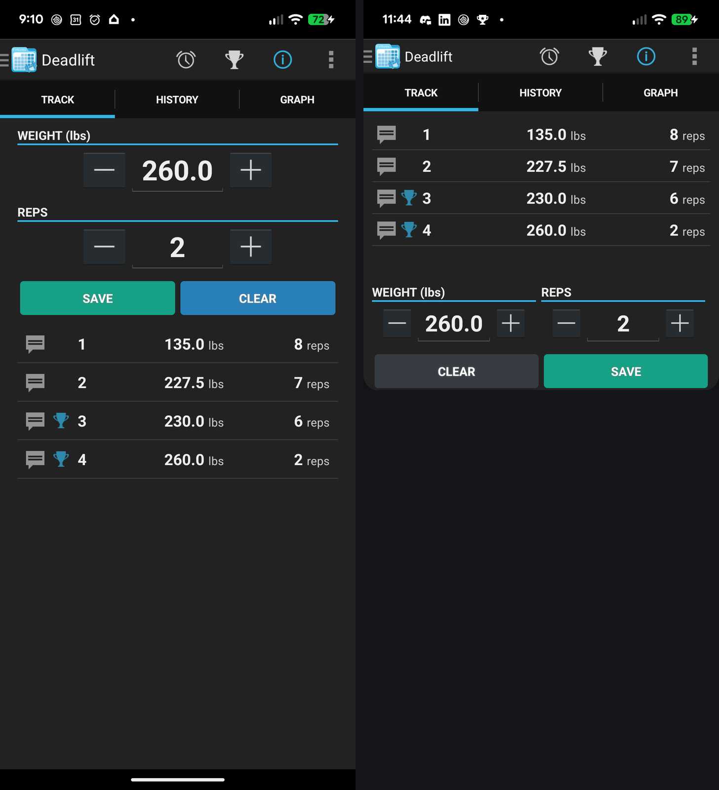
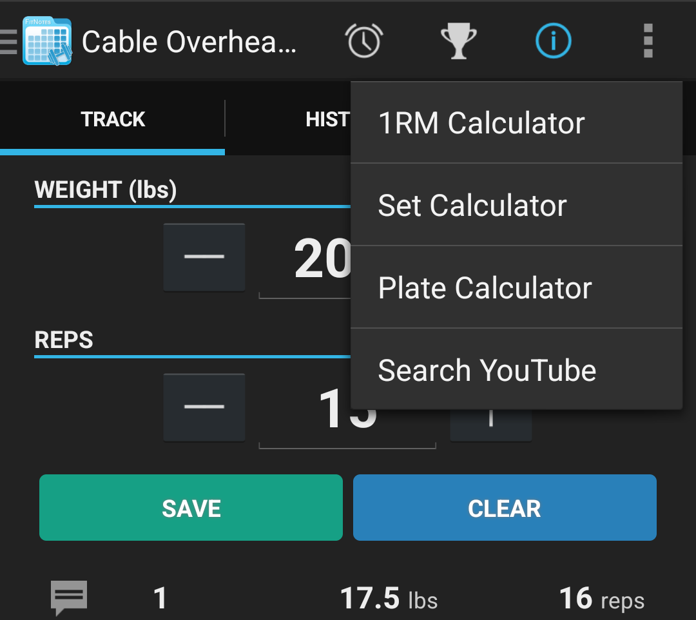

# FitNotes — Clicks Communicator mod (installable patch)

A patch that rebuilds **your own copy** of FitNotes 25.1 with a compact,
bottom-pinned Track screen for near-square displays — first target: the Clicks
Communicator (1080×1200, 9:10), verified via a Pixel 7a split-screen pane.

The patch is diffs only: nothing here distributes FitNotes itself, a signature,
or a keystore. Your build signs with your key, from your APK.

## Target look

Before → after on the Track screen (left: stock 25.1 at full phone ratio;
right: the modded build at the Communicator ratio — sets on top, 50/50
inputs, secondary action left):



## What changes
- input row compacted (WEIGHT/REPS side-by-side, smaller steppers + numerals)
- history list pins to the bottom, newest set nearest the inputs
- tighter global spacing; Progression-style dark restyle
- Track toolbar overflow gains **"Search YouTube"** — opens a YouTube search
  for that exercise's name, built at runtime (renames/new exercises just
  work; also works on an unpatched stock layout)
- (optional, conditional) sets auto-mark complete on save/update



See `patches/*.patch` for every hunk — plain XML (+ a little smali for the
YouTube wiring), human-readable.

## Quick start (humans)
```sh
# once: a JDK (java + keytool), patch, curl
bash build.sh "/path/to/FitNotes - Gym Workout Log_25.1_APKPure.apk"
# -> dist/fitnotes-modded-aligned-signed.apk
```
Then: export your data in-app and copy it off-device → uninstall FitNotes →
install the built APK → in-app Restore. (Uninstalling wipes the local database;
that export is your only safety net. Details: `AGENTS.md`.)

## Delegating to an AI agent
Give an agent this whole folder and say: *follow AGENTS.md in here*. It pins the
exact APK (sha256 in `manifest.txt`), verifies every step, and refuses to touch
your device without your confirmation.

## Files
| file | purpose |
|---|---|
| `AGENTS.md` | agent-facing full procedure + safety gates |
| `build.sh` | decode → patch → rebuild → sign, fail-loud, idempotent |
| `manifest.txt` | pinned APK/tools checksums and expectations |
| `patches/` | the mod: per-edit series `0NN-<edit-id>.patch` — bare unified diffs of the decoded APK tree only, applied in filename order, no authorship metadata |

Personal use only. Don't redistribute signed builds or your keystore.